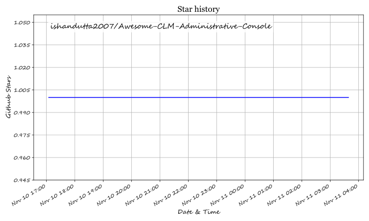

# Awesome-CLM-Administrative-Console

## Top CLM Administrative Console Ecosystem

**Curated List of SaaS Products & Open-Source GitHub Projects**  
*Focused on Role-Based Access Control, Tenant Configuration & Contract Lifecycle Governance*  
**Last updated: March 2026**

This repository tracks notable **SaaS platforms** and **open-source projects** for **CLM Administrative Console**. These tools provide the administrative backbone for contract lifecycle management systems—covering user role management, permission profile configuration, workflow routing rules, audit logging, and multi-tenant governance across legal, procurement, and sales contracts.

**Examples** include Icertis Admin Console, Ironclad Admin, DocuSign CLM Admin, Agiloft Configuration Console, Conga CLM Administrator, SirionLabs Admin, ContractPodAi Console, PandaDoc Workspace Settings, Concord Admin, and CobbleStone Admin (the category leaders).

**Open-source emphasis**: This section highlights every major active project for self-hosted CLM platforms with administrative consoles, role-based access control, and workflow configuration—ideal for legal operations teams, platform engineers, and organizations seeking transparent, vendor-neutral contract administration without per-seat enterprise licensing.

Contributions welcome! Open an PR to add/update entries. Keep descriptions factual and link to official sites.

## Table of Contents
- [SaaS/Hosted Platforms](#saas-products)
- [Open-Source GitHub Projects](#open-source-github-projects)
- [How to Contribute](#how-to-contribute)
- [Disclaimer](#disclaimer)

## SaaS/Hosted Platforms

| Product | Description | Pricing (Starting) | Free Tier / Trial Limits |
|---------|-------------|-------------------|--------------------------|
| **[Icertis Admin Console](https://www.icertis.com/)** | Enterprise CLM administrative interface with role-based access controls, user permission configuration, template and clause library management, and audit trails for AI-assisted actions. Admins configure workflow routing, approval chains, and notification rules from a personalized dashboard [citation:1]. | Quote-only (custom enterprise pricing) | No free tier; demo available via sales |
| **[Ironclad Admin](https://ironcladapp.com/)** | Administrative console with granular group-based permissions across workflows, records, and company settings. Seat types (Admin, Standard, Requester/Viewer) are determined by group memberships and permission configurations; custom admin groups can be created with scoped permissions (e.g., IT Admin without contract data access) [citation:2][citation:14]. | Custom pricing (Enterprise tier) | No free version; free trial available via sales |
| **[DocuSign CLM Admin](https://www.docusign.com/)** | Permission profile-based administration with three core profiles: CLM Admin (full repository access), CLM User (standard editing and viewing), and CLM Viewer (minimal upload/search access). Organization administrators manage user provisioning and group assignments separately from CLM Admin roles [citation:3][citation:15]. | Custom pricing (quote-only) | Free trial available on signup (limited time) |
| **[Agiloft Configuration Console](https://www.agiloft.com/)** | Group-based permission model where users inherit combined permissions from multiple groups. Supports layered groups (easier maintenance) or self-sufficient groups (easier troubleshooting); field-level permissions control which records and fields users can view or edit. Power Users vs. End Users distinguished by license type [citation:4]. | Custom pricing (quote-only) | No free tier; demo available |
| **[Conga CLM Administrator](https://www.conga.com/)** | Five core user profiles (including CLM Administrator) controlling object-level permissions and page layouts. Administrators configure process definitions, contributors, contract elements, and application tools. Permissions defined at profile level control access based on functional requirements [citation:5]. | Custom pricing (quote-only) | No free tier; demo available |
| **[SirionLabs Admin](https://sirion.tech/)** | Administrative configuration for user roles, approval workflows, and signature permissions. Enforces signing authority by contract type or value (e.g., sales contracts under $50K route to regional manager, above to legal/finance). Real-time role updates and comprehensive audit trails for all actions . | Custom pricing (quote-only) | No free tier; demo available |
| **[ContractPodAi Console](https://contractpodai.com/)** | Administrative controls including role-based access management with annual access reviews, segregation of duties evaluation, and termination-triggered access revocation. IT Administrator teams allocate assets and tool access based on defined roles [citation:7]. | Custom pricing (quote-only) | No free tier; demo available |
| **[PandaDoc Workspace Settings](https://www.pandadoc.com/)** | Five account roles with distinct permission sets: Account Owner (full access, billing, SSO), Admin (full workspace access), Manager (send/view all documents, add users), Team Member (own documents only), and Collaborator (view/comment on shared documents only). One Account Owner per account; users can hold different roles across multiple workspaces [citation:8]. | $19/user/month (Starter, annual billing) | Free eSign plan: unlimited documents, 60 signatures/year; 14-day Business trial |
| **[Concord Admin](https://www.concord.app/)** | Administrative settings for two-factor authentication enforcement, document tagging requirements, automatic signature requests upon final approval, AI feature toggles, and IP whitelisting (Enterprise). Custom branding and email server configuration available on Enterprise plans [citation:9]. | Custom pricing (quote-only) | No free tier; demo available |
| **[CobbleStone Admin](https://www.cobblestonesoftware.com/)** | Security Groups define user roles with bulk permission assignment. Admins create unlimited groups, assign security roles, and configure field restrictions and hidden fields per group. Scope options (My, My Department, All) control permission boundaries [citation:10]. | Custom pricing (quote-only) | No free tier; demo available |

## Open-Source GitHub Projects

| Project | Star Badge | Description |
|---------|------------|-------------|
| **[OpenCLM](https://github.com/qik-ai/openclm)** |  | Free, AGPL v3 CLM platform with 12 pre-built roles mapped to real org hierarchies (Super Admin, Administrator, Contract Manager, Legal Counsel, Finance Controller, Procurement Manager, Department Head, Contract Author, Reviewer, Auditor, External Counsel, Signatory). Features role-based access control with granular resource-level permissions, multi-tenancy for department isolation, Keycloak SSO, and full audit trail [citation:20][citation:21]. |
| **[Aakd](https://github.com/aaked-app/aakd)** |  | Open-source, self-hostable CLM for post-signature contract operations. Organization-scoped approvals, comments, notifications, and activity logs. REST API and scoped MCP endpoint for agent-assisted workflows. Docker Compose deployment with PostgreSQL, Redis, MinIO, and Mailpit [citation:23]. |
| **[draftLegal](https://github.com/AniketTati/draft-legal)** |  | Self-hosted AI-native CLM positioned as Ironclad + Harvey alternative. Agent chat with ~30 tools over contracts (search, cite, compare, draft, redline, route approvals). Portfolio intelligence via hybrid search (pgvector + Elasticsearch + RRF). Bring-your-own LLM key (Anthropic, OpenAI, Gemini). `docker compose up` deployment [citation:16][citation:28]. |

### Additional Strong Open-Source Options

| Project | Star Badge | Description |
|---------|------------|-------------|
| **[Wraft](https://github.com/wraft/wraft)** |  | Open-source Document Lifecycle Management platform (Elixir); community-listed under GitHub contract-management topic with ~55 stars [citation:29]. |
| **[ContractManager (Jameica)](https://github.com/janrieke/contractmanager)** |  | Contract management software plugin for the Jameica platform (Java); lightweight desktop-oriented contract administration [citation:29]. |

**Frameworks for building custom systems**: Combine **OpenCLM** for full lifecycle CLM with 12-role RBAC and Keycloak SSO, **Aakd** for post-signature obligation tracking with source-linked citations, and **draftLegal** for AI-assisted contract reasoning—all deployable via Docker Compose on self-managed infrastructure with PostgreSQL.

## How to Contribute

1. Fork the repo.
2. Add/edit entries in `README.md` (follow existing format).
3. Include: name, link, 1–2 sentence description, and whether it's SaaS or open-source.
4. Submit PR with a short explanation.

Star the repo if you find it useful!

## Disclaimer

- This is a **community-curated** list — not exhaustive and not an endorsement.
- CLM administrative consoles handle sensitive contract data and user permissions; enforce least-privilege role design, regular access reviews, and comprehensive audit logging.
- Self-hosted open-source CLM platforms require proper backup strategies, SSO configuration, and role hierarchy validation before production deployment.

---

**Made for legal operations administrators, CLM platform engineers, contract managers, and organizations building governed contract infrastructure.**  
Let's make CLM administration more open, granular, and auditable.

## ⭐ Star History

<a href="https://star-history.com/#ishandutta2007/Awesome-CLM-Administrative-Console&Timeline" align="center">
  <picture>
    <source media="(prefers-color-scheme: dark)" srcset="assets/ishandutta2007_Awesome-CLM-Administrative-Console_growth.svg">
    
  </picture>
</a>
