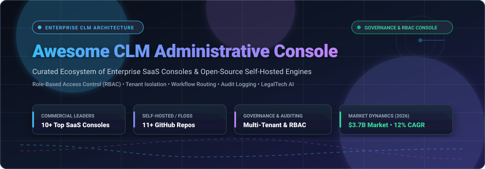

# 📑 Awesome-CLM-Administrative-Console ⚖️

### 🏢 Top CLM Administrative Console Ecosystem: Enterprise Governance & Open-Source Tools 🚀

 
 

  

> 🛡️ A curated directory of premier **SaaS platforms** and **open-source GitHub projects** for **Contract Lifecycle Management (CLM) Administrative Consoles**. Master role-based access control (RBAC), multi-tenant administration, workflow routing rules, audit logging, and enterprise contract governance. 📜✨

---

## 📑 Table of Contents
- [🌐 Sector Overview & Market Dynamics](#-sector-overview--market-dynamics)
- [💼 SaaS/Hosted Platforms](#-saashosted-platforms)
- [🔓 Open-Source GitHub Projects](#-open-source-github-projects)
- [🏛️ Comparative Architectural Matrix](#️-comparative-architectural-matrix)
- [🤝 How to Contribute](#-how-to-contribute)
- [⚠️ Disclaimer](#️-disclaimer)
- [☕ Support](#-support)
- [⭐ Star History](#-star-history)

---

## 🌐 Sector Overview & Market Dynamics

📊 The global Contract Lifecycle Management (CLM) software market size is estimated at approximately **$3.3 billion to $3.7 billion**, expanding rapidly at a compound annual growth rate (**CAGR**) of roughly **11.5% to 13.5%** driven by generative AI adoption, automated compliance obligations, and enterprise digital transformations. 

🧩 The sector remains **moderately to highly fragmented** rather than a "winner-take-all" monopoly: horizontal enterprise stalwarts (DocuSign, SAP, Conga) and category-defining pure-play titans (Icertis, Ironclad) dominate Global 2000 multi-tenant governance, while specialized agile vendors (PandaDoc, Concord) and emerging self-hosted open-source solutions capture mid-market, privacy-sensitive, and developer-first deployments.

---

## 💼 SaaS/Hosted Platforms

The table below compiles industry-leading commercial CLM administrative consoles, ranked descending by estimated company scale (valuation / market capitalization or annual revenue). 🏢📈

| 🏷️ Product | 💰 Company Scale (Valuation / Revenue) | 🏷️ Starting Pricing (Specific Tier) | ⏳ Free Tier / Trial Limits | ⚙️ Key Administrative & Console Capabilities |
|:---|:---|:---|:---|:---|
| **[DocuSign CLM Admin](https://www.docusign.com/)** | ~$15.0B Market Cap / ~$3.36B ARR | Custom annual contracts (Mid-market configs typically start ~$20,000–$50,000/year; base eSign starts $10/user/mo) | 30-day free trial (standard eSign/agreement cloud features); custom guided demo for enterprise CLM console | Three core permission profiles (CLM Admin, CLM User, CLM Viewer); decoupled organization user provisioning, custom permission profiles, and automated document workflow routing. |
| **[Icertis Admin Console](https://www.icertis.com/)** | ~$5.0B Valuation / ~$350M ARR | Enterprise deployments typically start ~$100,000–$300,000/year (custom annual agreement based on scope and seats) | No free tier or self-serve trial (0 trial days); interactive custom demo provided via enterprise sales consultation | Enterprise RBAC governance, personalized executive dashboards, clause & template library administration, AI action audit logs, and complex rule-based approval chains. |
| **[Ironclad Admin](https://ironcladapp.com/)** | ~$3.2B Valuation / ~$200M ARR | Custom enterprise contracts starting at ~$50,000–$120,000/year (legacy entry modules start ~$500/month) | 14-day free trial available for select evaluation workflows; no permanent free tier | Granular group-based access control, scoped administrator groups (e.g., IT Admin without contract payload visibility), workflow condition builder, and turn-key user provisioning. |
| **[PandaDoc Workspace Settings](https://www.pandadoc.com/)** | ~$1.0B Valuation / ~$100M ARR | $19/user/month billed annually ($35/user/month billed monthly) for Starter tier | Free eSign plan (unlimited document uploads & 60 signatures/year forever); 14-day free trial on Business/Enterprise tiers | 5 granular account roles (Account Owner, Admin, Manager, Team Member, Collaborator); cross-workspace role assignments, SSO configuration, and team-level document access sandboxing. |
| **[SirionLabs Admin](https://sirion.tech/)** | ~$1.0B Valuation / ~$85M Revenue | Custom annual enterprise license; Salesforce AppExchange tiers list starting at $1,500/user/year (~$125/user/month) | No self-serve free trial (0 trial days); enterprise proof-of-concept and sandbox evaluation via sales | Enforces signing authority matrices by monetary thresholds ($50K+ legal/finance escalation), real-time role permission updates, and comprehensive multi-tier audit trails. |
| **[Agiloft Configuration Console](https://www.agiloft.com/)** | KKR Majority-Owned / ~$71M Revenue | Custom quote-based pricing; third-party enterprise benchmarks estimate entry tiers starting ~$65–$150/user/month (median ~$60,000/year) | No permanent free tier for core CLM; free tier available strictly for Agiloft Astra AI assistant; guided sandbox demo upon request | Group-based inherited security architecture; layered vs. self-sufficient permission groups, field-level record access masking, and Power User vs. End User licensing segregation. |
| **[Conga CLM Administrator](https://www.conga.com/)** | ~$715M Valuation / ~$380M Revenue | Custom enterprise pricing; individual AppExchange components start at $35/user/month, with full CLM suites starting ~$100–$500/user/month | No free trial for core CLM suite (0 trial days); 30-day free trial available specifically for Conga Composer on Salesforce AppExchange | Five pre-built system user profiles controlling object-level CRUD permissions, dynamic page layout rendering, and administrative process routing definitions. |
| **[ContractPodAi Console](https://contractpodai.com/)** | ~$695M Valuation / ~$55M Revenue | Custom annual platform subscriptions; entry-level mid-market tiers start ~$50,000–$65,000/year (unlimited seats model) | No free tier or self-serve trial (0 trial days); guided enterprise Leah AI sandbox upon request | Role-based permission controls featuring segregation-of-duties enforcement, mandatory annual access reviews, automated offboarding de-provisioning, and legal ops asset mapping. |
| **[Concord Admin](https://www.concord.app/)** | ~$47.7M Total Funding / ~$20M+ Revenue | $499/month billed annually ($5,988/year) for Essentials tier including 5 user seats (extra users $49/user/month) | 14-day free trial on all standard plans (no credit card required); no perpetual free tier | Centralized administrative portal managing 2FA enforcement, mandatory document tagging rules, automated signature triggering, clause library controls, and IP whitelisting. |
| **[CobbleStone Admin](https://www.cobblestonesoftware.com/)** | Bootstrapped / ~$26.5M Revenue | Standard tiers start at ~$59/user/month (Express/Enterprise deployments with base licensing and user packages) | 30-day free trial (*CobbleStone Contract Insight* free web trial); scheduled guided enterprise demo | Security Groups framework supporting unlimited custom security roles, field-level masking, departmental scope boundaries (My, My Department, All), and bulk access assignments. |

---

## 🔓 Open-Source GitHub Projects

Self-hosted and community-driven contract lifecycle management engines, document intelligence frameworks, and electronic agreement tools. Sorted descending by GitHub stargazers. 🌟💻

| 📦 Project | ⭐ Stars | 🛠️ Tech Stack & Architecture | 🔐 Administrative, RBAC & Console Highlights |
|:---|:---|:---|:---|
| **[Documenso](https://github.com/documenso/documenso)** |  | TypeScript, Next.js, Prisma, PostgreSQL | Modern, open-source document signing and workflow governance infrastructure; team role management, granular access scopes, audit trails, and multi-tenant organization settings. |
| **[OpenSign](https://github.com/OpenSignLabs/OpenSign)** |  | Node.js, React, MongoDB / PostgreSQL, Docker | Full-featured open-source digital signature and agreement solution with admin console, user role controls, multi-organization tenant switching, and tamper-proof PDF audit certificates. |
| **[OpenContracts](https://github.com/Open-Source-Legal/OpenContracts)** |  | Python, Django, React, Celery, Vector Search | Open-source legal document intelligence and DMS built for complex contract parsing; corpus administration, RBAC access boundaries, annotation version control, and vector-backed querying. |
| **[Wraft](https://github.com/wraft/wraft)** |  | Elixir, Phoenix, LiveView, PostgreSQL | Open-source document and contract lifecycle engine; collaborative workflow state machines, document revision audit logs, and permission-aware approval pipelines. |
| **[Onto-Contract](https://github.com/sharptoolbox/Onto-Contract)** |  | Python, Knowledge Graphs, Vue.js | Ontology-driven AI-native contract management platform; structured contract attribute extraction, semantic clause governance, and relationship tracking across counterparty agreements. |
| **[claw](https://github.com/CoinCulture/claw)** |  | Go, CLI, Markdown / Git Engine | Command-line contract management system for legal engineers and developers; treats legal agreements as code with git-based version tracking, hash-verified states, and automated lifecycle triggers. |
| **[draftLegal](https://github.com/AniketTati/draft-legal)** |  | Python, FastAPI, React, pgvector, Elasticsearch | Self-hosted AI-native CLM platform (Ironclad + Harvey alternative); privacy-preserving local LLM routing, hybrid search over agreement portfolios, redlining tools, and team approval gates. |
| **[ContractManager (Jameica)](https://github.com/janrieke/contractmanager)** |  | Java, SWT, Jameica Plugin Framework | Desktop-oriented contract management plugin for the Jameica platform; tracks renewal deadlines, cost allocations, counterparty details, and automated expiration warnings. |
| **[edictum-console](https://github.com/edictum-ai/edictum-console)** |  | TypeScript, Node.js, Next.js, Docker | Self-hostable operations console for governed contract agents; human-in-the-loop (HITL) approval workflows, contract lifecycle monitoring, and tamper-evident audit feeds. |
| **[ContractManagmentSystem](https://github.com/ahmed7am1d/ContractManagmentSystem)** |  | C#, ASP.NET Core MVC (.NET 6), SQL Server | Enterprise administrative console implementation featuring ASP.NET Identity role management, user client tracking, agreement state transitions, and audit trails. |
| **[Aakd](https://github.com/aaked-app/aakd)** |  | TypeScript, PostgreSQL, Redis, MinIO, Docker Compose | Self-hostable post-signature contract operations suite; org-scoped approval hierarchies, source-linked citation inspection, and scoped MCP endpoints for AI agent execution. |

---

## 🏛️ Comparative Architectural Matrix

| 🔍 Feature | 🏢 Enterprise SaaS (Icertis, DocuSign, Ironclad) | 🚀 Mid-Market SaaS (Concord, PandaDoc) | 💻 Open-Source Self-Hosted (draftLegal, OpenContracts, Documenso) |
|:---|:---|:---|:---|
| **Deployment Model** | Multi-tenant SaaS / Virtual Private Cloud | Multi-tenant Public Cloud | On-premises, Bare Metal, Docker Compose, Kubernetes |
| **RBAC Granularity** | Field-level masking, layered user groups, conditional routing | Role presets (Admin, Member, Viewer, Manager) | Database-level RBAC, custom claims, or Keycloak/OIDC integration |
| **Data Sovereignty** | SOC 2 Type II, ISO 27001, HIPAA, Regional Data Centers | SOC 2, GDPR compliant cloud storage | 100% internal data retention; zero third-party telemetry |
| **Cost Predictability** | High ($20K–$300K+/yr), annual/multi-year lock-in | Predictable monthly/yearly per-seat pricing ($19–$499/mo) | Zero license fees; infrastructure and operational maintenance only |
| **AI Governance** | Vendor-managed proprietary models + audit trails | Cloud LLM integrations (OpenAI / Anthropic) | Bring-Your-Own-Key (BYOK) or local private models (Ollama, vLLM) |

---

## 🤝 How to Contribute

We welcome additions, updates, and architectural corrections from the community! 💡✨

1. 🍴 **Fork** this repository.
2. 🌿 Create a new branch: `git checkout -b feature/add-new-clm-tool`.
3. 📝 Add your entry to `README.md` following the established table structure.
   - For **SaaS**: Include product name, scale/valuation, specific starting tier pricing, explicit trial limits, and admin console features.
   - For **Open-Source**: Provide name, social star badge linked to `/stargazers`, tech stack, and administrative capabilities.
4. 🔍 Verify all Markdown links and badge syntax.
5. 🚀 Submit a **Pull Request** detailing why the tool should be added.

---

## ⚠️ Disclaimer

- 📌 This repository is a **community-curated index** created for educational, architectural, and evaluation purposes; it does not constitute an official endorsement of any vendor or codebase.
- 🔒 CLM administrative consoles handle mission-critical, confidential legal contracts and access credentials. Always validate role hierarchies, enforce multi-factor authentication (MFA), and perform security audits before production rollout.

---

## ☕ Support

Thank you for exploring and utilizing the **Awesome CLM Administrative Console** directory! If this ecosystem guide and benchmark have saved you time or aided your architectural decisions, please consider supporting the project:

- ⭐ **Star** this repository to show your appreciation and help others discover it.
- 🍴 **Fork** and contribute new tools or architectural refinements.
- 📢 **Share** this resource with your colleagues, legal operations engineers, and developer communities.
- 💖 **Sponsor / Buy a Coffee**: Support continuous open-source maintenance and research directly via the [GitHub Sponsors Dashboard](https://github.com/sponsors/ishandutta2007).

---

##  Star History

